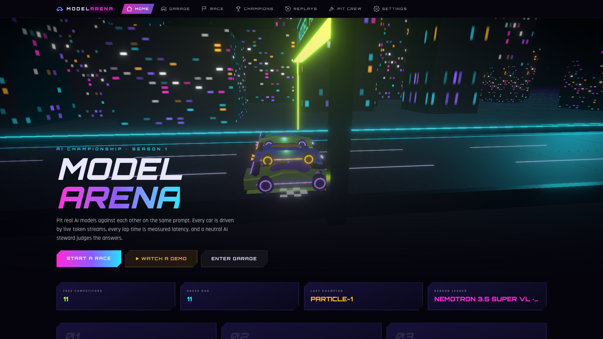

# Model Arena

**A futuristic AI racing simulator where real AI models compete through live inference, 3D racing and AI-powered judging.**

One prompt goes to up to five real AI models at the same moment. Their answers stream live, a neutral AI judge scores
every answer blind, and the result becomes a race: tokens move the cars, the judge's scores decide the podium.

Built from scratch for **AppFusion Hackathon 2026 (TRU AI Club)** by **Apex Intelligence** — Khushmeet Kaur Bade.



**Live:** https://model-arena-lake.vercel.app (demo races open to everyone; live races need the owner code) ·
**Demo video:** `video/Model-Arena-Demo.mp4` (2:45, in the submission ZIP — problem, a genuine AI race with real answers and judging, the mobile app, limitations)

## Problem and users
Comparing models normally means pasting the same prompt into several tools and judging the answers by hand.
Model Arena puts them side by side, scores them and makes the difference visible — for students, developers,
AI enthusiasts and educators.

## Seven sections
| Section | What it does |
|---|---|
| **Home** | Stats, demo races, recent real races, provider status |
| **Garage** | Verified free models; pick up to 5; Paint Shop (colour, number 1–99, body style, nickname) |
| **Race** | Prompt + presets, starting grid, request budget, 3-2-1 start, live 3D race, HUD, Team Radio (live answers), judge, podium, all answers |
| **Champions** | Leaderboard from real races: wins, podiums, DNFs, average quality, latency |
| **Replays** | Every real race replayed at its original timing; three clearly labelled DEMO races |
| **Pit Crew** | Key status, daily and per-minute free quota, cooldowns, revalidation |
| **Settings** | Scoring weights, judge model, max tokens, timeout, system prompt; paid providers locked |

## How the AI works
Same prompt → every model concurrently (OpenRouter, free models only) → streamed answers → blind AI judge
(accuracy, helpfulness, clarity, completeness 0–10) → **total = 65 % quality + 25 % speed + 10 % completion** →
ranking → champion → saved replay. See `documentation/AI-integration.md`.

Real vs simulated: genuine races come from live OpenRouter inference. The three demo races are scripted,
use fictional racers, are labelled **DEMO RACE — SIMULATED RESULTS** and never count in Champions.

## Run locally
Requirements: Node.js 24+, a free key from https://openrouter.ai/settings/keys.
```bash
git clone https://github.com/KhushmeetBade/model-arena && cd model-arena
npm install
cp .env.example .env     # put OPENROUTER_API_KEY=... in .env; keep ALLOW_PAID_PROVIDERS=false
npm run dev              # open http://localhost:5173 (API on 127.0.0.1:8787; saving .env restarts it)
```
Production mode locally: `npm start` (builds and serves everything on http://localhost:8787).

## Tests
```bash
npm test          # 74 tests: server (57) + client (17); mock providers only, no AI requests
npm run build     # TypeScript checks + production build
```
`server/test/ui-harness.ts` is a test-only server (port 8788) with scripted models and a TEST MODE banner.

## Deploy to Vercel (free Hobby plan)
1. vercel.com → **Add New → Project → Import** `KhushmeetBade/model-arena` (settings come from `vercel.json`).
2. Project → **Storage → Create → Blob**, access **Private**, connect to the project (adds `BLOB_READ_WRITE_TOKEN`).
3. Project → **Settings → Environment Variables**: `OPENROUTER_API_KEY` (your key), `ARENA_ACCESS_CODE`
   (owner code for live races), `ALLOW_PAID_PROVIDERS=false`. Optional `ARENA_MAX_LIVE_RACES_PER_DAY` (default 5).
4. Redeploy. Everyone can browse, watch demos and replays; live races and settings changes need the access code.

## Security
Server-side key only · free models only (every price field = 0) · paid providers hard-locked · whole-race quota
preflight · owner access code + daily cap on public deployments · host/origin guard · safe answer rendering.
See `documentation/security.md`.

## Documentation
`documentation/architecture.md` · `AI-integration.md` · `security.md` · `testing.md` · `judge-QA.md` ·
`rubric-mapping.md` · `SUBMISSION.md` · `video/SCRIPT.md` (final video timeline) ·
`presentation/` (8-slide .pptx + matching PDF; rebuild with `python3 presentation/build_deck.py`)

## Known limitations
LLM judging is subjective; results depend on prompt, criteria and model availability; free models are often
rate-limited; free availability and limits are controlled by OpenRouter and can change. Mobile layout verified in
Chrome mobile emulation (320–390 px); physical-iPhone testing is still to do.

## Future
Custom judging criteria, multiple judges, benchmark prompt sets with statistics, more providers, usability study.

---
Built with AI-assisted development (Claude Code). The application's AI inference comes only from OpenRouter free models.
